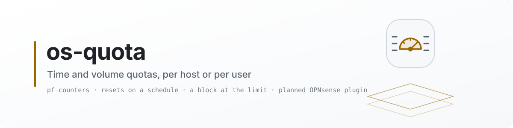

<picture>
  <source media="(prefers-color-scheme: dark)" srcset="docs/images/readme/banner-dark.svg">
  <source media="(prefers-color-scheme: light)" srcset="docs/images/readme/banner-light.svg">
  
</picture>

<p align="center">
  
  <a href="https://github.com/AbdelmonemAwad/os-quota/actions/workflows/checks.yml"></a>
  <a href="LICENSE"></a>
  <a href="#what-is-tested"></a>
  <a href="https://github.com/AbdelmonemAwad/opnsense-arabic"></a>
  <a href="https://github.com/AbdelmonemAwad/os-xgs-npu"></a>
</p>

# Quotas for OPNsense

Time and volume quotas per host - per user and group with os-useridentity is the next part - from pf's counters, which include the connections the coprocessor forwards, started again on a cycle and enforced by a block at the limit.

> ~~**Planned - nothing here runs yet.** This repository was opened on 2026-11-16 to hold
> Quotas as a plugin of its own. No code has been written or moved into it, and there is no
> release.~~
>
> **Written, not released (2026-11-20).** The first part is here: a quota for each host named, by
> volume, by minutes of use or both, on a daily, weekly or monthly cycle, counted from pf's states once a
> minute, and the host blocked at the limit until its cycle starts again. Off by default. It has not run
> on an appliance yet: what was run is under [What is tested](#what-is-tested).

<p align="center"><b>Contents:</b> <a href="#what-it-does">What it does</a> &middot; <a href="#how-a-host-is-counted">How a host is counted</a> &middot; <a href="#what-it-does-not-do">What it does not do</a> &middot; <a href="#not-yet-and-why">Not yet, and why</a> &middot; <a href="#what-is-tested">What is tested</a> &middot; <a href="#installation">Installation</a> &middot; <a href="#updates">Updates</a> &middot; <a href="#where-it-fits">Where it fits</a> &middot; <a href="#licence">Licence</a></p>

## What it does

**Firewall: Quotas** (XGS: Quotas, order 62, when os-xgs-npu is installed), one page, off by default:

- **a quota for a host** - one IPv4 or IPv6 address, or a MAC: a MAC's addresses are taken from
  OPNsense's own host discovery at each read - those it saw in the last hour, through
  `configctl hostwatch dump`'s script; the ARP and neighbour tables where that cannot be run - so a
  device with IPv4 and IPv6 keeps one quota while its IPv6 addresses change. Each quota has a volume in
  megabytes (1 MB = 1,000,000 bytes, both ways together), minutes of use, or both, and a cycle: daily
  from 00:00, weekly from Monday 00:00, or monthly from the 1st, in the firewall's time zone. A host may
  have more than one - a daily time and a monthly volume;
- **the count** - once a minute, from cron, from pf's states (below), every byte of the host's
  connections: to and from the firewall itself too, so a proxy on it hides nothing, and what the
  coprocessor forwards where os-xgs-npu gives pf its counts;
- **minutes of use** - a minute of the clock in which the host moved more than **Minute of use above**,
  in Settings, both ways together: empty unless the owner types a value, and empty is the plugin's own,
  **100 KB, a provisional value** (below). 0 makes any byte a minute of use;
- **the block** - a host over a quota goes into the pf table `quota_over`, an alias of type External in
  Firewall: Aliases that the plugin makes, and rules the plugin registers - never among the owner's in
  Firewall: Rules - block, on every interface and before the owner's rules, everything it sends past the
  firewall, every new connection to it, and what it sends to the firewall itself but DNS and the web GUI:
  every other TCP and UDP port, ICMP, and the tunnels' own protocols - IP in IP, IPv6 in IP, GRE, ESP and
  AH (another protocol addressed to the firewall, a routing protocol's, stays the owner's rules' to
  decide). DNS and the web GUI are left out of the block, not let through: OPNsense's anti-lockout rule and
  the owner's own rules decide them as they did before the host went over, so a quota locks nobody out -
  the owner on his own PC among them - and lets nobody in where the owner's rules keep a network away
  from the firewall. Every rule is a block. The host keeps its address: OPNsense's own DHCP and IPv6
  neighbour rules come first;
- **the cut** - a block stops new connections only. Where os-xgs-npu is installed, `quota_over` is put
  in XGS: Settings' "Cut open connections when listed": its next minute cuts the connections the host
  already has open, in hardware first where "Cut in hardware" is on. It is put there once, and the
  plugin keeps a record of it: one the owner takes out stays out, and the page says the host then keeps
  what it has open. Without os-xgs-npu the plugin cuts them itself, at once, by each state's id, as
  OPNsense's own Sessions page does - and with it too wherever os-xgs-npu's `lists_cut.py` would not:
  it cuts only an address that its own record of the table's last run does not hold, so the plugin reads
  that record (`/var/db/os-xgs-npu/lists/quota_over.json`) and cuts a host it already holds - put back
  in the table after a boot, after the plugin was turned off and on, after a Reset and a second overrun
  within that minute - and every host while `quota_over` was never put in the list (os-xgs-npu installed
  since the last Apply; the page says so). The first read after a pause - the plugin on again, a CARP
  backup become master - cuts every blocked host's connections: what it opened while nothing blocked it,
  or what pfsync brought from the other firewall, is open still;
- **a new cycle** - the count starts again from nothing and the host passes again; **Reset** on a
  quota's row does the same by hand, now. A boot in the middle of a cycle loses no count: the counts are
  kept in `/var/db/os-quota`, and a read at the end of the boot fills the table again;
- **the cards and tabs** - the hosts over a quota, those at 80 % or more of one, what the quotas counted
  in their cycles with the last read, the last error - and a fifth card where os-xgs-npu is installed
  with its "Count hardware traffic in pf" off. Then Quotas (each quota with what its host used of its
  volume and its minutes, its cycle's end and its state, Reset, Apply) and Settings.

## How a host is counted

The way is phase 0's, settled on 2026-11-17 and 2026-11-18 by the plan, the new-plugin standard and a
lab on the second XGS 3300 and the XGS 136 - pf's counting and the drivers', measured before this
plugin existed:

- **from pf's states** - a table entry's counters never see a connection the coprocessor forwards: in
  the lab, one in hardware left 50 packets on the entry and 4,109,662,792 bytes on its state. The state
  is where os-xgs-npu's "Count hardware traffic in pf" puts the coprocessor's counts. So the plugin
  reads `pfctl -vvs state` once a minute and keeps, for each connection of a watched host, what it last
  counted;
- **one connection, one count** - a routed connection has a state on each interface it crosses, each
  holding the whole connection: its states are grouped by their stack-side ends, the same on all of
  them, and counted once. Through outbound NAT the lab's one group held 4,109,698,792 bytes against
  4,109,622,375 received at the far end;
- **only what is new** - a connection the last read held counts what it gained since; one that began
  since counts whole; one that was there before the quota was, or before the plugin was turned on,
  counts from then on, never what it carried before. A state of a connection that ends before the other
  is never counted again;
- **how close, as measured** - a long TCP connection in hardware: pf's count matched the wire within
  320 to 595 bytes of 4.1 GB on the XGS 3300, and within about 7 KB of 2 GB on the XGS 136; it reached
  its final count 1 to 4 s after the wire on the 3300, 0 to 2 s on the 136. A UDP stream at 500 Mbit/s:
  within 0.035 %. Short connections in hardware lost their counts on the 3300 when the coprocessor let go
  of their flows (0.2 to 0.57 % of their payload counted) until os-xgs-npu's pull request #1191, on its
  main since 2026-11-18: with it, 20 short connections there counted 104.17 % of their payload, which
  with its headers is 102.74 %, and a stream handed back to the host mid-transfer lost nothing in pf; the
  XGS 136 counted short connections whole before it (102.99 %). With "Count hardware traffic in pf" off,
  pf held 0.001 % of a 4.1 GB transfer: what the host carried before the connection went into hardware;
- **what a minute misses** - a state stays in pf after its last packet by OPNsense's default timeouts -
  20 s for ICMP, 30 s for a one-way UDP stream, 60 s for UDP both ways, 90 s for a closed TCP connection -
  so a minute's read sees most connections' ends; a state that goes sooner than a minute can end between
  two reads, and what it carried after the last read is lost;
- **the cost** - one `pfctl -vvs state` a minute: 0.01 s for 10,554 lines under 1,024 streams in the lab.
  Only the watched hosts' states are read past their first line, so a firewall of 100,000 states with a
  few hosts watched is read in a fraction of the time;
- **who counts** - on a CARP backup nothing is counted or blocked: it holds pfsync's copies of the
  master's states, and the master counts.

**Minute of use above - provisional.** The plan takes its value from a measurement of an idle real
device on both appliances - what a phone or a laptop with a way to the internet moves in a minute while
nobody uses it - and that has not been taken: phase 0's machine had no way out, and moved nothing in its
half hour. Until it is, the plugin's own value is 100 KB, a first value of this build. It is one setting,
left empty unless the owner types a value, and empty is the plugin's own value, which is never written
into config.xml: the release that takes the measured value changes it on every firewall where it is
empty, and an owner's own value stays his.

## What it does not do

- **no exact stop at the limit** - a host can go past its volume by what it moves until the next read,
  up to a minute, plus the few seconds the coprocessor's counts take to reach pf; with os-xgs-npu's cut,
  its open connections run up to another minute. At hardware rates that is gigabytes. **Not measured
  yet** on either appliance;
- **not the ISP's count** - pf counts IP bytes, headers included, not Ethernet frames, and a quota counts
  to and from the firewall itself too;
- **no host behind a router by its MAC** - the firewall sees the router's: name such a host by its
  address;
- **never the firewall's own addresses** - a quota naming one counts nothing and blocks nothing, and
  the page says so;
- **nothing with an alias `quota_over` that is the owner's** - while one of that name that the plugin did
  not make is in Firewall: Aliases, no host is blocked, and its table is never emptied or changed - not
  when the plugin is installed, turned off or removed; the page says so;
- **no totals shared between two firewalls in CARP** - after a failover the other one counts from what it
  last counted itself, if it ever was master;
- **no block through a port forward whose filter rule is "Pass"** - such a forward is written `rdr pass`,
  and pf checks no filter rule for what it lets in, the plugin's blocks among them: a host over its
  quota keeps what the forward carries - a server of its own behind a forward from the WAN, its traffic
  redirected to a proxy on the firewall. A forward with "Add associated filter rule", or none, is blocked;
- **no web page for a blocked device** - nothing tells it why. It keeps DNS and the firewall's GUI only
  where the owner's rules give them to it.

## Not yet, and why

- **quotas per user and per group** - the plan's phase 2, with os-useridentity's map of addresses to
  users; so is a cycle that starts on a day the owner chooses.
- **an alert before the limit** - phase 2 as well, through os-netreport's alert layer.
- **the lab** - none of this has run on an appliance yet. The plan's tests: a known volume through a
  connection in hardware and one through the host against a small quota, the block and the cut at the
  limit with the overshoot measured, many short connections, a time quota, a cycle's start, a reboot in
  the middle of a cycle, a filter reload while a host is blocked, removal - on the second XGS 3300, the
  XGS 136 and a plain OPNsense - and the idle devices for Minute of use above. With them, the block's
  rules as pf loads them, a host over its quota on a network whose rules keep it away from the firewall,
  and the cut after a boot, after the plugin off and on, and on a CARP master's return.
- **IPv6 in hardware** - counted as IPv4 is by the code; phase 0's lab had no IPv6 to measure it with.
- **the page in a browser** - not opened yet, in either theme or language.

## What is tested

On 2026-11-20, from this branch, away from an appliance - the checks, run under Python 3.14 and PHP 8.5:

- **pf's states** - `tools/test-states.py`, 33 checks, on `tools/fixtures/states-26.7.txt`, laid out as
  phase 0's capture on the second XGS 3300 with every address a documentation one: each first line's
  protocol, its stack-side ends and the end that made it - through outbound NAT, a port forward, IPv6,
  GRE with no ports, an if-bound state, a redirect to 127.0.0.1 - one count for a connection's two
  states, bytes up from the end that made it, the ids with a gateway or route-to beside them, only the
  watched hosts' states read past their first line, the same answer with and without the quick look
  through, what a cut kills, and 100,000 states read;
- **the count, the cycles and the block** - `tools/test-account.py`, 109 checks with a stand-in pfctl and
  firewall: the settings from a `config.xml` - the minute threshold left empty among them - the hosts
  taken and refused, the cycles in UTC and around the clock changes of Europe/Berlin, America/New_York
  and America/Santiago (which changes at midnight), what a connection gained, a connection begun since,
  one older, a tuple reused, a state ending first, a restart from the saved state, a second quota on one
  host, the minutes of use and their threshold, the cycle turning, a clock set back, a clock a day ahead
  and back, a real-time clock at 2001 after a boot, the table filled, emptied and filled again, the cut
  here without os-xgs-npu and, with a stand-in of its `lists_cut.py` keeping its record on disk, here
  only where that would not cut - a boot, the plugin off and on, a CARP master's return, a Reset and a
  second overrun, quota_over never listed or taken out by the owner, a record it cannot read - the
  firewall's own address never blocked, a MAC's addresses changing, the alias missing or not the
  plugin's, the owner's alias of that name never emptied, pfctl refusing, off, a CARP backup, the reset,
  the command line and its lock, a read waiting for the lock while the removal takes its directory, the
  page's status;
- **the firewall hook** - `tools/test-firewall-hook.py`, 39 checks, os-xgs-npu's harness: the rules
  through each OPNsense's own method names (26.7, 26.7.3 to 26.7.8, 27.1), nothing but blocks, and what
  they do to a probe each way by pf's first quick match - DNS and the web GUI on the firewall left to the
  anti-lockout and the owner's rules, everything else of a host over its quota blocked, a host under it
  never matched - the web GUI's ports as core's anti-lockout has them, nothing while off or without the
  plugin's own alias, a refusing object not stopping the reload;
- **the alias** - `tools/test-aliases.php`, 28 checks, with stand-ins for OPNsense's Alias model and
  os-xgs-npu's XGS model: made, refreshed, switched off where a rule names it, removed, the owner's of the
  same name left; the cut list keeping the owner's entries, the alias put there once and recorded, not
  put back once the owner took it out; and `aliases.php` run as configd runs it;
- **the model** - `tools/test-model.php`, 40 checks: the hosts taken and refused, a limit required,
  minutes within the cycle, the model's XML in step with the scripts - the minute threshold with no
  default written, empty being the scripts' own value;
- **the page's API** - `tools/test-mvc.php`, 19 checks: the status, Apply's order on and off, the Reset
  and its id, the rows;
- **the page's script** - `tools/test-page.py`, 26 checks, under node with a stand-in jQuery: the cards,
  the quiet lines - XGS: Settings' cut in hardware first or not, quota_over taken out of its cut list or
  never put there - the grid's formatters, Reset asking first, Apply from each tab, the markup and the
  script in step, and the note under the grid on the overshoot and the block;
- **the installation** - `tools/test-install.py`, 33 checks, the installer, the removal, the package's
  scripts, `place-menu.sh` and the boot's hook in a temporary root: every file laid down with its mode
  and taken away, the menu at XGS 62 or under Firewall, nothing copied with a syntax error, the table
  taken out of pf, nothing done by the old package in an upgrade, cron's line and the boot's hook gone
  before a read in progress is ended, and a read ended again before the state goes;
- **the self-update** - `tools/test-self-update.py`, 45 checks, as os-blocklists has it;
- **the strings** - `tools/check-strings.py`: each of the 84 strings the GUI shows is in `source.json`;
  21 have their Arabic in opnsense-arabic already, the other 63 wait for it there;
- **the rest** - every installed file removed by the uninstaller (`tools/check-uninstall.sh`), `php -l`,
  `py_compile` and pyflakes, `sh -n`, XML and JSON, nothing private, no Arabic in the code, the copyright
  line; and, by hand, the page kit (kit).

Not tested: anything on an appliance (above).

## Installation

It is not in the OPNsense plugin repository, so there is no `pkg install os-quota`, and there is no
release yet.

**From a checkout** of this repository, on the firewall, as root:

```sh
sh install/install.sh
```

It checks the PHP with `php -l` and the Python with `py_compile` before anything is copied, copies
`src/` onto `/usr/local`, puts the page in the menu (`place-menu.sh`: XGS with os-xgs-npu, Firewall
without), and does what the page's Apply does. Nothing is counted or blocked until it is turned on in
Settings and quotas are given. Safe to run again: the settings in config.xml and the counts are kept. No
package is needed beside it: pfctl, Python and PHP are OPNsense's own. On an XGS 3300, short connections
in hardware are counted with os-xgs-npu from its pull request #1191 on.

`sh install/uninstall.sh` empties the table, takes `quota_over` out of Firewall: Aliases and XGS:
Settings' cut list (switched off instead where a rule or a setting still names it), removes its files and
its counts, and takes the table out of pf. The settings stay in config.xml.

**From a package**, once there is a release: `tools/make-package.sh` builds it on a firewall, and
`release.yml` in a FreeBSD virtual machine for each release, as os-blocklists does.

## Updates

As os-blocklists: taken by hand, to this repository's **releases** - from **XGS: Updates**, its
*Plugins* tab, where an os-xgs-npu that lists this plugin is installed, or by running
`/usr/local/opnsense/scripts/quota/self-update.py` (`check` to ask). A release is installed only as its
owner signed it (`release.json` and its Ed25519 signature, the public key in `release-keys/`), only
forward, by the `install/install.sh` it carries. No cron entry runs it.

## Where it fits

It is one part of the [os-xgs-npu](https://github.com/AbdelmonemAwad/os-xgs-npu) project, which puts OPNsense on Sophos XGS hardware, and works the way its other plugins do: changes by pull request, a release installed from **XGS: Updates**, its Arabic in [opnsense-arabic](https://github.com/AbdelmonemAwad/opnsense-arabic)'s catalogue. It installs the same on a plain OPNsense, where pf alone carries the traffic and the plugin cuts a blocked host's connections itself.

## Licence

BSD 2-Clause - see [LICENSE](LICENSE).
